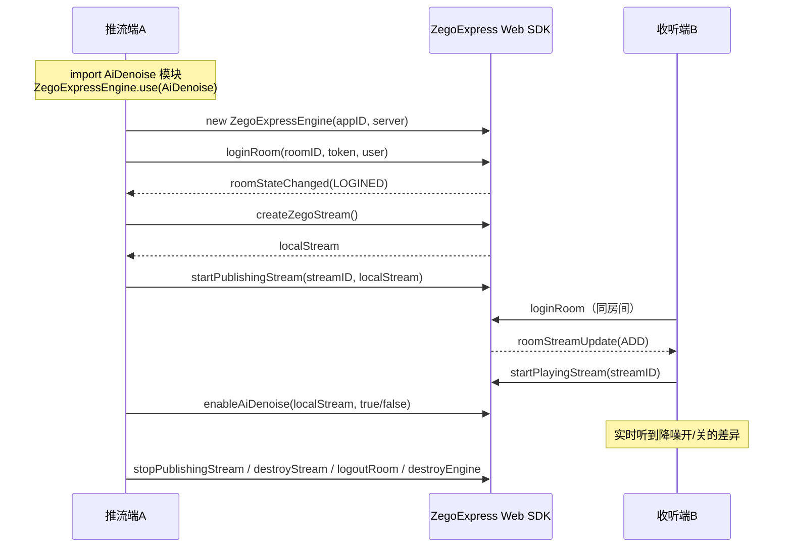

# ZEGO Express Web SDK — AI 降噪快速接入示例

一个最小可运行的 Web 示例：**创建引擎 → 登录房间 → 本地推流 → 开启/关闭 AI 降噪** 的完整主链路，页面提供 AI 降噪对照开关，可现场听出开/关差异。

AI 降噪能力基于 `AiDenoise` 模块与 `enableAiDenoise` 接口（注意：Web 端 AI 降噪不走 Native 端的 `enableANS`/`setANSMode`）。

## 环境要求

| 项目 | 要求 |
| --- | --- |
| Node.js | 18.0 或以上（建议 20+） |
| 浏览器（推流端） | AI 降噪支持 Chrome 66+、Edge 79+、Firefox 76+、Safari 14.1+；**推荐最新版 Chrome / Edge**（官方建议，保证稳定性） |
| 浏览器（移动端） | 推荐 Safari 或 Chrome 96+；部分 Android 微信浏览器可能出现轻微电流声 |
| 网络 | 需能访问 ZEGO 音视频云（HTTPS/WebSocket） |

限制：AI 降噪同一时间只支持对**一条流**处理；页面需运行在 `localhost` 或 HTTPS 下（浏览器 getUserMedia 安全要求，本地开发用 `localhost` 即可）。

## 前提条件：获取 AppID、Server 地址与 Token

1. 登录 [ZEGO 控制台](https://console.zego.im)（海外控制台为 [console.zegocloud.com](https://console.zegocloud.com)）。
2. 「项目管理」中创建/选择项目，在「项目信息」中获取：
   - **AppID**：数字类型，页面必填；
   - **Server 地址**：接入服务器地址（注意不是 ServerSecret）；SDK **3.7.0 及以上版本可留空**（页面 Server 输入框留空即可）；
   - **临时 Token**（有效期为 24 小时，仅调试用）：控制台「项目信息」页可直接生成，参见[控制台 - 临时 Token](https://doc-zh.zego.im/console/development-assistance/temporary-token)。正式环境请从自己的业务服务器生成 Token 下发。

> 本示例不在代码中保存任何凭据：AppID / Server / RoomID / UserID / Token 全部在页面输入框中填写。

## 运行步骤

```bash
cd .claude/skills/design-example-architecture/examples/ai-noise-reduction-web
npm install
npm run dev
```

启动后用**最新版 Chrome** 打开终端输出的地址（默认 `http://localhost:5173`）。

## 如何听出 AI 降噪的开/关差异

推流端自己听不到本端声音，需要**第二个入会端**收听，推荐两种方式：

1. **同一台电脑**：再开一个浏览器标签页打开 `http://localhost:5173`，填写**相同 AppID、相同 RoomID**、**不同的 UserID**（例如 `user-a` / `user-b`）和各自 Token，两边都点「登录房间并推流」，互相能听到/看到对方。
2. **两台设备**：另一台设备用 Chrome/Safari 打开同一 URL（需同一路由器/内网或用内网穿透，且地址需为 HTTPS 或 localhost）。

测试步骤：

1. 在推流端 A 点「登录房间并推流」，收听端 B 能听到 A 的环境声音；
2. 在 A 端制造持续噪音（见下方噪音源建议）；
3. 在 A 端切换「AI 降噪」开关（开 → 关 → 开），B 端耳机里即可听出明显差异：开启后风扇声、键盘声等非人声噪声被抑制，人声保留。

噪音源建议（稳定、对照明显）：

- 风扇 / 空调 / 空气净化器等稳态噪音（效果最直观）；
- 机械键盘敲击、桌面敲击（非稳态噪音）；
- 对麦克风吹气、咳嗽声；
- 也可播放白噪音音频对着麦克风。

## 页面操作说明

| 输入/控件 | 说明 |
| --- | --- |
| AppID | 控制台「项目信息」中的数字 AppID |
| Server 地址 | 控制台「项目信息」中的 Server 地址；SDK ≥ 3.7.0 可留空 |
| RoomID | 自定义，两个入会端保持一致 |
| UserID | 自定义，需全局唯一，两个入会端必须不同 |
| Token | 控制台临时 Token 或业务服务器下发的 Token |
| 登录房间并推流 | 依次执行：创建引擎 → 登录房间 → 创建本地流 → 推流 |
| AI 降噪开关 | 推流成功后可用，实时调用 `enableAiDenoise` 生效 |
| 退出房间 | 停止推流 → 销毁流 → 登出房间 → 销毁引擎 |

页面底部「运行日志」会输出每一步的执行结果与错误码，排障时请先看日志。

## API 调用时序



## 涉及的 API

| API | 说明 | 官方文档 |
| --- | --- | --- |
| `ZegoExpressEngine.use(AiDenoise)` | 注册 AI 降噪模块，必须在 `new ZegoExpressEngine` 之前调用 | [AI 降噪](https://doc-zh.zego.im/real-time-video-web/audio/scenario-based-ai-noise-reduction) |
| `new ZegoExpressEngine(appID, server)` | 创建引擎 | [API 参考](https://doc-zh.zego.im/real-time-video-web/client-sdk/api-reference/class) |
| `loginRoom` / `logoutRoom` | 登录 / 退出房间 | 同上 |
| `createZegoStream` / `destroyStream` | 创建 / 销毁本地流 | 同上 |
| `startPublishingStream` / `stopPublishingStream` | 开始 / 停止推流 | 同上 |
| `enableAiDenoise(localStream, enable)` | 开 / 关 AI 降噪（推流前或推流中均可切换） | [AI 降噪](https://doc-zh.zego.im/real-time-video-web/audio/scenario-based-ai-noise-reduction) |
| `checkSystemRequirements` | 浏览器兼容性检测 | 同上 |

> `setAiDenoiseMode`（AIBalanced 均衡模式）当前官网 SDK 不包含，需联系 ZEGO 技术支持特殊编包，本示例不涉及。

## 目录结构

```tree
ai-noise-reduction-web/
├── index.html        # 页面结构与样式（配置表单、降噪开关、视频窗口、日志）
├── src/
│   └── main.js       # 全部 SDK 逻辑（单文件：引擎→登录→推流→AI 降噪开关→退出）
├── package.json
└── README.md
```

## 常见问题

- **登录房间失败 / token 无效**：临时 Token 有效期 24 小时，过期后请到控制台重新生成；`userID` 必须与生成 Token 时传入的一致。
- **开启 AI 降噪失败，错误码 1103081**：当前浏览器缺少所需 API（如 AudioWorklet），请改用最新版 Chrome/Edge。
- **听不到差异**：确认是**收听端**（另一标签页/设备）在听，而不是推流端本机外放；噪音源尽量靠近麦克风；建议佩戴耳机避免回声干扰。
- **看不到画面/听不到声音**：允许浏览器摄像头、麦克风权限；`localhost` 或 HTTPS 环境才可采集媒体流。
- **页面必须本地起服务吗**：是。直接双击打开 `index.html` 无法加载 npm 依赖，请按「运行步骤」使用 `npm run dev`。
