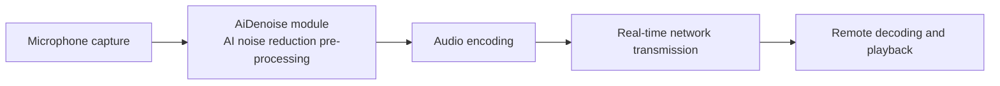

# AI Noise Reduction Quick Start

- - -

This article describes how to integrate the AI (Artificial Intelligence) noise reduction feature of the ZEGO Express SDK into your Web app with streamlined steps: register the noise reduction module, create the engine and the local stream, publish the stream and enable noise reduction, and run through the complete workflow of "capturing noisy audio on one end while the remote end hears clean sound".

AI noise reduction builds on traditional noise reduction (stationary noise suppression; for details, please refer to [Audio 3A Processing](/real-time-video-web/audio/audio-3a-processing)) and simultaneously eliminates non-stationary noise such as keyboard typing, tapping, and environmental wind, preserving pure human voice. It is suitable for 1v1 or multi-person audio/video call scenarios such as conferences, voice chat rooms, and in-game voice chat.

**Office scenario** (the original audio contains mouse clicks, keyboard typing, applause, friction sounds, office chatter, air conditioner noise, and more):

Original audio:

<audio src="https://doc-media.zego.im/sdk-doc/doc/video/Express_Video_SDK/Audio/office_noise_original.mp3" controls>Your browser does not support the audio tag.</audio>

After AI noise reduction:

<audio src="https://doc-media.zego.im/sdk-doc/doc/video/Express_Video_SDK/Audio/office_noise_AIDenoise.mp3" controls>Your browser does not support the audio tag.</audio>

**Public place scenario** (the original audio contains rain, tram sounds, cooking sounds, cars rushing past, and more):

Original audio:

<audio src="https://doc-media.zego.im/sdk-doc/doc/video/Express_Video_SDK/Audio/public_noise_original.mp3" controls>Your browser does not support the audio tag.</audio>

After AI noise reduction:

<audio src="https://doc-media.zego.im/sdk-doc/doc/video/Express_Video_SDK/Audio/public_noise_AIDenoise.mp3" controls>Your browser does not support the audio tag.</audio>

## Feature Overview

### Eliminable Noise

After AI noise reduction is enabled, noise in the following typical scenarios can be eliminated:

| Scenario | Typical Noise |
| --- | --- |
| Meeting room | Keyboard sounds, table tapping |
| Office | Keyboard sounds, nearby colleagues talking |
| Transportation | Whistles, cars rushing past, in-car music, rain and windshield wiper sounds |
| Internet cafe | Keyboard sounds, nearby people talking |
| Coffee shop | Chairs dragging, people talking nearby, sharp clattering |

### Noise Reduction Modes

| Noise Reduction Mode | Characteristics | Applicable Scenarios |
| --- | --- | --- |
| AI | (Default) Lightweight mode with low performance cost | Indoor noise environments such as offices and meeting rooms |
| AIBalanced | Balanced mode that delivers stronger noise suppression with the same voice fidelity, at a higher performance cost than the lightweight mode | Noisy outdoor environments such as streets, roads, and markets |

The SDK publicly released on the official website uses the lightweight AI mode by default, requiring no additional configuration; for how to use the AIBalanced mode, please refer to step 5 of [Implementation Steps](#implementation-steps).

### Known Limitations

- Only one stream can be processed by AI noise reduction at a time; denoising multiple streams simultaneously is not supported.
- AI noise reduction works on the publishing end (after capture and before encoding), and the playing end requires no extra processing; the publishing end usually does not play its own sound out loud, so the effect must be verified by listening on the other end. For the method, please refer to [How to Verify the Noise Reduction Effect](#how-to-verify-the-noise-reduction-effect).
- The page must run on localhost or HTTPS for the browser to allow microphone capture.

## How It Works

On the Web, AI noise reduction is provided as a feature module (AiDenoise): the module must be registered through `ZegoExpressEngine.use` before the engine is created. Once noise reduction is enabled, the SDK pre-processes the captured audio on the publishing end, preserving human voice and suppressing noise. The processed audio is then encoded and published to the ZEGOCLOUD real-time audio/video cloud, and every listener in the room hears the denoised audio.



## Prerequisites

Before implementing the AI noise reduction feature, make sure that:

- You have created a project in the [ZEGOCLOUD Console](https://console.zegocloud.com) and obtained a valid `AppID` and `Server address`. For details, please refer to [Console - Project Information](/console/project-info).
- You have integrated the ZEGO Express Web SDK (`zego-express-engine-webrtc` 2.19.0 or later) into your project and implemented basic audio/video publishing and playing. For details, please refer to [Quick Start - Integration](/real-time-video-web/quick-start/integrating-sdk) and [Quick Start - Implementation](/real-time-video-web/quick-start/implementing-video-call).
- You are using a browser that supports AI noise reduction. Compatibility is shown in the table below.

| Platform | Browser | Minimum Version |
| --- | --- | --- |
| PC | Google Chrome | 66.0 |
| PC | Microsoft Edge | 79.0 |
| PC | Firefox | 76.0 |
| PC | Safari | 14.1 |
| Mobile | Safari | 96.0 |
| Mobile | Google Chrome | 96.0 |

For the stability of the AI noise reduction feature, the latest Google Chrome or Microsoft Edge is recommended on PC, and Safari or Google Chrome 96.0 or later on mobile; crackling noise may occur in the WeChat browser on Android.

## Sample Code

We provide a complete, runnable Web sample (Vite + vanilla JavaScript) that covers the full workflow of "create engine -> log in to room -> publish stream -> enable/disable AI noise reduction", with a built-in AI noise reduction toggle and runtime logs. It is located in the repository directory `.claude/skills/design-example-architecture/examples/ai-noise-reduction-web/`.

Steps to run:

```bash
cd .claude/skills/design-example-architecture/examples/ai-noise-reduction-web
npm install
npm run dev
```

After it starts, open the address printed in the terminal (default `http://localhost:5173`) with the latest Chrome, and enter the AppID, RoomID, UserID, and Token on the page to try it out; for the two-end listening test method and noise source suggestions, please refer to the `README.md` in that directory.

## Implementation Steps

The following steps match the core workflow of the complete sample above, one action per step, and you can integrate them in order in your own project.

### 1 Integrate the SDK and register the AiDenoise module

Integrate the SDK through npm. For other integration methods, please refer to [Quick Start - Integration](/real-time-video-web/quick-start/integrating-sdk):

```bash
npm install zego-express-engine-webrtc
```

Before creating the engine, import and register the AiDenoise module:

```javascript
import { ZegoExpressEngine } from "zego-express-engine-webrtc";
import { AiDenoise } from "zego-express-engine-webrtc/aidenoise";

// Must be called before new ZegoExpressEngine
ZegoExpressEngine.use(AiDenoise);
```

<Warning title="Warning">

`ZegoExpressEngine.use(AiDenoise)` must be called before `new ZegoExpressEngine`; if the module is registered after the engine is created, AI noise reduction will not take effect.

</Warning>

### 2 Create the engine and log in to a room

Create the engine (`appID` is of the Number type; for SDK 3.7.0 and later, `server` can be an empty string), listen for room state changes, and log in to a room:

```javascript
// Create the engine
const zg = new ZegoExpressEngine(appID, server);

// Room state callback: publishing and playing are possible only after the room connection succeeds (LOGINED)
zg.on("roomStateChanged", (roomID, reason, errorCode) => {
  console.log(`Room state changed: ${roomID} ${reason} ${errorCode}`);
});

// Log in to the room; obtain the token from the ZEGOCLOUD Console (temporary Token, valid for 24 hours) or from your business server
const loginResult = await zg.loginRoom(
  roomID,
  token,
  { userID, userName: userID },
  { userUpdate: true }
);
```

<Note title="">

Before the call, you can call `checkSystemRequirements` to check the current browser's compatibility; if the check fails, please switch to a recommended browser.

</Note>

### 3 Create a local stream and publish it

Call [createZegoStream](@createZegoStream) to create a local stream (capturing the camera and microphone by default), preview the video, and publish the stream:

```javascript
// Create the local stream
const localStream = await zg.createZegoStream();
// Preview the local video
localStream.playVideo(document.querySelector("#local-video"), { enableAutoplayDialog: true });

// Start publishing; streamID is defined by you and must be globally unique under the same AppID
const streamID = `stream-${userID}-${Date.now()}`;
zg.startPublishingStream(streamID, localStream);
```

### 4 Enable AI noise reduction

Call [enableAiDenoise](@enableAiDenoise), passing in the media stream that needs noise reduction, to enable AI noise reduction. It can be called before or during publishing, and takes effect on the local stream in real time:

```javascript
// Enable AI noise reduction; the interface returns Promise<ZegoServerResponse>, and errorCode 0 indicates success
await zg.enableAiDenoise(localStream, true);
```

### 5 Switch the noise reduction mode

This step is optional. The lightweight AI mode is used by default and requires no additional configuration; to get stronger noise suppression in noisy outdoor environments, you can switch to the balanced AIBalanced mode.

To use the AIBalanced mode, remove the import and registration of the AiDenoise module and import the VoiceChanger module instead (the registration must likewise be called before `new ZegoExpressEngine`):

```javascript
// import { AiDenoise } from "zego-express-engine-webrtc/aidenoise";
// ZegoExpressEngine.use(AiDenoise);

// Import the audio processing module
import { VoiceChanger } from "zego-express-engine-webrtc/voice-changer";
// Must be called before new ZegoExpressEngine
ZegoExpressEngine.use(VoiceChanger);
```

Then call [setAiDenoiseMode](@setAiDenoiseMode) to set the noise reduction mode:

```javascript
// Set to the balanced AIBalanced mode
await zg.setAiDenoiseMode(localStream, 1);
// Switch back to the lightweight AI mode
await zg.setAiDenoiseMode(localStream, 0);
```

<Warning title="Warning">

The SDK publicly released on the official website does not include the AIBalanced mode and uses the AI mode by default. To use the AIBalanced mode, please contact ZEGOCLOUD Technical Support for a special build.

</Warning>

### 6 Disable AI noise reduction and release resources

This step is optional and is executed when exiting a call or falling back to traditional noise reduction:

```javascript
// Disable AI noise reduction
await zg.enableAiDenoise(localStream, false);

// Recommended release order when exiting a call
zg.stopPublishingStream(streamID); // Stop publishing
zg.destroyStream(localStream); // Destroy the local stream
zg.logoutRoom(roomID); // Log out of the room
zg.destroyEngine(); // Destroy the engine
```

## API Reference

The AI noise reduction interfaces involved on this page are as follows; for the complete definitions of common interfaces such as stream creation, publishing, and playing ([createZegoStream](@createZegoStream), [startPublishingStream](@startPublishingStream), and more) and the static module registration method `ZegoExpressEngine.use`, please refer to [Function Overview](/real-time-video-web/client-sdk/api-reference/function-list).

### enableAiDenoise

Passes in a media stream to enable or disable AI noise reduction. For the complete definition, please refer to [enableAiDenoise](@enableAiDenoise).

```typescript
enableAiDenoise(localStream: MediaStream | ZegoLocalStream, enable: boolean): Promise<ZegoServerResponse>
```

| Parameter | Type | Description |
| --- | --- | --- |
| localStream | MediaStream \| ZegoLocalStream | The media stream that needs noise reduction; a ZegoLocalStream instance created by `createZegoStream` can be passed in |
| enable | boolean | true means enable, false means disable |

Supported versions: Web SDK 2.19.0 and later. When to call: after the stream is successfully created by `createZegoStream`; it can be called before or during publishing.

### setAiDenoiseMode

Sets the AI noise reduction mode. For the complete definition, please refer to [setAiDenoiseMode](@setAiDenoiseMode).

```typescript
setAiDenoiseMode(localStream: MediaStream | ZegoLocalStream, mode: AiDenoiseMode): Promise<ZegoServerResponse>
```

| Parameter | Type | Description |
| --- | --- | --- |
| localStream | MediaStream \| ZegoLocalStream | The media stream to configure |
| mode | AiDenoiseMode | 0: AI mode (default); 1: balanced AIBalanced mode |

Supported versions: Web SDK 3.3.0 and later. The AIBalanced mode requires a special build from ZEGOCLOUD Technical Support before it can be used.

## Notes and Troubleshooting

### How to Verify the Noise Reduction Effect

The publishing end cannot hear its own noise reduction effect locally; another endpoint in the room is needed to listen and compare:

1. Two endpoints log in to the same room: open two browser tabs on the same computer (UserIDs must be different), or open the same page on two devices.
2. Publishing end A creates continuous noise: steady noise such as fans, air conditioners, or air purifiers gives the most obvious effect; mechanical keyboard typing or blowing into the microphone also works.
3. Listening end B wears headphones and toggles the AI noise reduction switch on end A (on -> off -> on) to hear the difference: with it enabled, noise is suppressed while human voice is preserved.

### Troubleshooting

| Symptom | Possible Cause | Solution |
| --- | --- | --- |
| Enabling AI noise reduction fails with error code 1103081 | The current browser lacks the capabilities required by AI noise reduction (such as AudioWorklet) | Switch to the latest Google Chrome or Microsoft Edge |
| Error code 1103080 | AI noise reduction runtime error | Disable and re-enable it; if it persists, switch browsers and contact ZEGOCLOUD Technical Support |
| No audible noise reduction effect | Listening on the publishing end itself, or the noise source is too far from the microphone | Listen with headphones on the other endpoint; move the noise source closer to the microphone |
| Call lag or abnormal audio quality | Insufficient device performance | Follow the degradation path below |

### Degradation Path for Insufficient Performance

If the device overheats, lags, or the audio sounds abnormal after AI noise reduction is enabled, handle it in the following order:

1. If the balanced AIBalanced mode is in use, switch back to the default lightweight AI mode to reduce the performance cost.
2. Disable AI noise reduction (`enableAiDenoise(localStream, false)`), and fall back to traditional 3A noise reduction (AEC echo cancellation, AGC automatic gain control, ANS noise suppression); for configuration, please refer to [Audio 3A Processing](/real-time-video-web/audio/audio-3a-processing).
3. If the problem persists, contact ZEGOCLOUD Technical Support and provide the AppID, the UserID that encountered the problem, the time of occurrence, error codes, and audio recordings before and after noise reduction, to help locate the issue.

For more capabilities: the AIBalanced mode and scenario-based music fidelity, please refer to [AI Noise Reduction](/real-time-video-web/audio/scenario-based-ai-noise-reduction).
