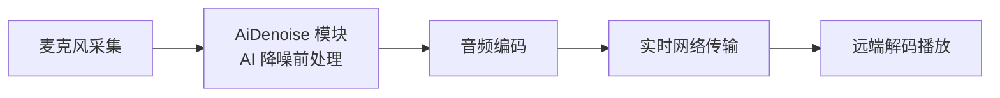

# AI 降噪快速接入

---

本文介绍如何在 Web 端以精简步骤接入 ZEGO Express SDK 的 AI（Artificial Intelligence，人工智能）降噪功能：注册降噪模块、创建引擎与本地流、推流并开启降噪，跑通"采集噪音、远端听感干净"的完整链路。

AI 降噪在传统降噪（稳态噪声抑制，详情请参考 [音频 3A 处理](/real-time-video-web/audio/audio-3a-processing)）的基础上，同步消除键盘声、敲击声、环境风声等非稳态噪声，保留纯净人声，适用于会议、语聊房、语音开黑等 1v1 或多人音视频通话场景。

**办公室场景**（原始音频包含鼠标点击声、键盘声、鼓掌声、摩擦声、办公室嘈杂声、空调声等）：

原始音频：

<audio src="https://doc-media.zego.im/sdk-doc/doc/video/Express_Video_SDK/Audio/office_noise_original.mp3" controls>您的浏览器不支持 audio 标签。</audio>

AI 降噪后：

<audio src="https://doc-media.zego.im/sdk-doc/doc/video/Express_Video_SDK/Audio/office_noise_AIDenoise.mp3" controls>您的浏览器不支持 audio 标签。</audio>

**公共场所场景**（原始音频包含雨声、电车声、炒菜声、汽车呼啸声等）：

原始音频：

<audio src="https://doc-media.zego.im/sdk-doc/doc/video/Express_Video_SDK/Audio/public_noise_original.mp3" controls>您的浏览器不支持 audio 标签。</audio>

AI 降噪后：

<audio src="https://doc-media.zego.im/sdk-doc/doc/video/Express_Video_SDK/Audio/public_noise_AIDenoise.mp3" controls>您的浏览器不支持 audio 标签。</audio>

## 功能介绍

### 可消除的噪声

开启 AI 降噪后，以下典型场景中的噪声可以被消除：

| 场景 | 典型噪声 |
| --- | --- |
| 会议室 | 键盘声、桌子敲击声 |
| 办公室 | 键盘声、周围同事说话声 |
| 交通工具 | 汽笛声、汽车经过的呼啸声、车载音乐声、雨声及雨刮声 |
| 网吧 | 键盘声、周围人语音声 |
| 咖啡厅 | 椅子拖动声、周围人说话声、尖锐碰撞声 |

### 降噪模式

| 降噪模式 | 特点 | 适用场景 |
| --- | --- | --- |
| AI | （默认）轻量模式，性能消耗低 | 办公室、会议室等室内噪音环境 |
| AIBalanced | 均衡模式，在人声保真效果相同的前提下噪声抑制能力更强，性能消耗高于轻量模式 | 街道、马路、市场等嘈杂的户外环境 |

官网公开发布的 SDK 默认使用 AI 轻量模式，无需任何额外设置；AIBalanced 模式的使用方式请参考 [实现步骤](#实现步骤) 第 5 步。

### 已知限制

- 同一时间仅支持对一条流进行 AI 降噪处理，不支持同时对多条流降噪。
- AI 降噪作用于推流端（采集后、编码前），拉流端无需任何处理；推流端本机通常不外放自己的声音，效果验证需要在另一端收听，方法请参考 [如何确认降噪生效](#如何确认降噪生效)。
- 页面需运行在 localhost 或 HTTPS 环境下，浏览器才允许采集麦克风。

## 实现原理

Web 端 AI 降噪以功能模块（AiDenoise）的形式提供：模块必须在创建引擎前通过 `ZegoExpressEngine.use` 注册；开启降噪后，SDK 在推流端对采集到的音频做前处理，保留人声、抑制噪声，处理后的音频再编码推送到 ZEGO 实时音视频云，房间内所有收听端听到的都是降噪后的声音。



## 前提条件

在实现 AI 降噪功能之前，请确保：

- 已在 [ZEGO 控制台](https://console.zego.im) 创建项目，并获取有效的 `AppID` 和 `Server 地址`，详情请参考 [控制台 - 项目信息](/console/project-info)。
- 已在项目中集成 ZEGO Express Web SDK（`zego-express-engine-webrtc` 2.19.0 或以上版本），并实现了基本的音视频推拉流功能，详情请参考 [快速开始 - 集成 SDK](/real-time-video-web/quick-start/integrating-sdk) 和 [快速开始 - 实现视频通话](/real-time-video-web/quick-start/implementing-video-call)。
- 使用支持 AI 降噪的浏览器，兼容性如下表所示。

| 平台 | 浏览器 | 最低版本 |
| --- | --- | --- |
| PC | Google Chrome | 66.0 |
| PC | Microsoft Edge | 79.0 |
| PC | Firefox | 76.0 |
| PC | Safari | 14.1 |
| 移动端 | Safari | 96.0 |
| 移动端 | Google Chrome | 96.0 |

为保证 AI 降噪功能的稳定性，推荐在 PC 端使用最新版 Google Chrome 或 Microsoft Edge 浏览器，在移动端使用 Safari 或 Google Chrome 96.0 以上浏览器；Android 微信浏览器上可能出现电流声。

## 示例代码

我们提供了一个完整可运行的 Web 示例（Vite + 原生 JavaScript），覆盖"创建引擎 → 登录房间 → 推流 → 开启/关闭 AI 降噪"的完整链路，页面内置 AI 降噪对照开关与运行日志，位于仓库目录 `.claude/skills/design-example-architecture/examples/ai-noise-reduction-web/`。

运行步骤：

```bash
cd .claude/skills/design-example-architecture/examples/ai-noise-reduction-web
npm install
npm run dev
```

启动后使用最新版 Chrome 打开终端输出的地址（默认 `http://localhost:5173`），在页面中填写 AppID、RoomID、UserID、Token 即可开始体验；双端听感测试方法与噪音源建议请参考该目录中的 `README.md`。

## 实现步骤

以下步骤与上述完整示例的核心链路一致，一个动作一步，您可以在自己的项目中按顺序接入。

### 1 集成 SDK 并注册 AiDenoise 模块

通过 npm 集成 SDK，其他集成方式请参考 [快速开始 - 集成 SDK](/real-time-video-web/quick-start/integrating-sdk)：

```bash
npm install zego-express-engine-webrtc
```

在创建引擎之前，引入并注册 AiDenoise 模块：

```javascript
import { ZegoExpressEngine } from "zego-express-engine-webrtc";
import { AiDenoise } from "zego-express-engine-webrtc/aidenoise";

// 必须在 new ZegoExpressEngine 之前调用
ZegoExpressEngine.use(AiDenoise);
```

<Warning title="注意">

`ZegoExpressEngine.use(AiDenoise)` 必须在 `new ZegoExpressEngine` 之前调用；模块注册晚于引擎创建时，AI 降噪功能无法生效。

</Warning>

### 2 创建引擎并登录房间

创建引擎（`appID` 为 Number 类型；SDK 3.7.0 及以上版本 `server` 可传空字符串），监听房间状态并登录房间：

```javascript
// 创建引擎
const zg = new ZegoExpressEngine(appID, server);

// 房间状态回调：与房间连接成功（LOGINED）后才能推流、拉流
zg.on("roomStateChanged", (roomID, reason, errorCode) => {
  console.log(`房间状态变更：${roomID} ${reason} ${errorCode}`);
});

// 登录房间；token 从 ZEGO 控制台（临时 Token，有效期 24 小时）或您的业务服务器获取
const loginResult = await zg.loginRoom(
  roomID,
  token,
  { userID, userName: userID },
  { userUpdate: true }
);
```

<Note title="">

通话前可调用 `checkSystemRequirements` 检测当前浏览器的兼容性，检测不通过时请更换为推荐浏览器。

</Note>

### 3 创建本地流并推流

调用 [createZegoStream](@createZegoStream) 接口创建本地流（默认采集摄像头与麦克风），预览画面并推流：

```javascript
// 创建本地流
const localStream = await zg.createZegoStream();
// 预览本地画面
localStream.playVideo(document.querySelector("#local-video"), { enableAutoplayDialog: true });

// 开始推流；streamID 由您定义，需在同一 AppID 下全局唯一
const streamID = `stream-${userID}-${Date.now()}`;
zg.startPublishingStream(streamID, localStream);
```

### 4 开启 AI 降噪

调用 [enableAiDenoise](@enableAiDenoise) 接口，传入需要降噪的媒体流，开启 AI 降噪。推流前或推流中均可调用，对本端流实时生效：

```javascript
// 开启 AI 降噪；接口返回 Promise<ZegoServerResponse>，errorCode 为 0 表示调用成功
await zg.enableAiDenoise(localStream, true);
```

### 5 切换降噪模式

本步骤为可选步骤。默认已使用 AI 轻量模式，无需任何设置；如需在嘈杂户外环境中获得更强的噪声抑制能力，可切换为 AIBalanced 均衡模式。

使用 AIBalanced 模式时，需要去掉 AiDenoise 模块的引入与注册，改为引入 VoiceChanger 模块（同样必须在 `new ZegoExpressEngine` 之前调用）：

```javascript
// import { AiDenoise } from "zego-express-engine-webrtc/aidenoise";
// ZegoExpressEngine.use(AiDenoise);

// 音频处理模块引入
import { VoiceChanger } from "zego-express-engine-webrtc/voice-changer";
// 需要在 new ZegoExpressEngine 前调用
ZegoExpressEngine.use(VoiceChanger);
```

再调用 [setAiDenoiseMode](@setAiDenoiseMode) 接口设置降噪模式：

```javascript
// 设置为 AIBalanced 均衡模式
await zg.setAiDenoiseMode(localStream, 1);
// 恢复为 AI 轻量模式
await zg.setAiDenoiseMode(localStream, 0);
```

<Warning title="注意">

当前官网公开发布的 SDK 不包含 AIBalanced 模式，默认直接使用 AI 模式。如果您需要使用 AIBalanced 模式，请联系 ZEGO 技术支持特殊编包。

</Warning>

### 6 关闭 AI 降噪并释放资源

本步骤为可选步骤，在退出通话或需要回退传统降噪时执行：

```javascript
// 关闭 AI 降噪
await zg.enableAiDenoise(localStream, false);

// 退出通话时的推荐释放顺序
zg.stopPublishingStream(streamID); // 停止推流
zg.destroyStream(localStream); // 销毁本地流
zg.logoutRoom(roomID); // 退出房间
zg.destroyEngine(); // 销毁引擎
```

## API 参考

本页涉及的 AI 降噪接口如下；流、推拉流等通用接口（[createZegoStream](@createZegoStream)、[startPublishingStream](@startPublishingStream) 等）与功能模块注册静态方法 `ZegoExpressEngine.use` 的完整定义，请参考 [常用接口列表](/real-time-video-web/client-sdk/api-reference/function-list)。

### enableAiDenoise

传入媒体流，开启或关闭 AI 降噪，完整定义请参考 [enableAiDenoise](@enableAiDenoise)。

```typescript
enableAiDenoise(localStream: MediaStream | ZegoLocalStream, enable: boolean): Promise<ZegoServerResponse>
```

| 参数 | 类型 | 描述 |
| --- | --- | --- |
| localStream | MediaStream \| ZegoLocalStream | 需要降噪的媒体流，可传入 `createZegoStream` 创建的 ZegoLocalStream 实例对象 |
| enable | boolean | true 表示开启，false 表示关闭 |

支持版本：Web SDK 2.19.0 及以上版本。调用时机：`createZegoStream` 创建流成功后，推流前或推流中均可调用。

### setAiDenoiseMode

设置 AI 降噪模式，完整定义请参考 [setAiDenoiseMode](@setAiDenoiseMode)。

```typescript
setAiDenoiseMode(localStream: MediaStream | ZegoLocalStream, mode: AiDenoiseMode): Promise<ZegoServerResponse>
```

| 参数 | 类型 | 描述 |
| --- | --- | --- |
| localStream | MediaStream \| ZegoLocalStream | 需要设置的媒体流 |
| mode | AiDenoiseMode | 0：AI 模式（默认）；1：AIBalanced 均衡模式 |

支持版本：Web SDK 3.3.0 及以上版本。AIBalanced 模式需联系 ZEGO 技术支持特殊编包后使用。

## 注意事项与排障

### 如何确认降噪生效

推流端本机听不到自己的降噪效果，需要另一个入会端收听对比：

1. 两个入会端登录同一房间：同一台电脑开两个浏览器标签页（UserID 必须不同），或两台设备访问同一页面。
2. 推流端 A 制造持续噪音：风扇、空调、空气净化器等稳态噪音效果最直观，也可使用机械键盘敲击声，或对麦克风吹气。
3. 收听端 B 佩戴耳机，在 A 端切换 AI 降噪开关（开 → 关 → 开），即可听出开启后噪声被抑制、人声保留的差异。

### 常见问题排障

| 现象 | 可能原因 | 处理方式 |
| --- | --- | --- |
| 开启 AI 降噪失败，错误码 1103081 | 当前浏览器不支持 AI 降噪所需能力（如 AudioWorklet） | 更换最新版 Google Chrome 或 Microsoft Edge 浏览器 |
| 错误码 1103080 | AI 降噪运行错误 | 关闭后重新开启；若持续出现，更换浏览器并联系 ZEGO 技术支持 |
| 错误码 1103082 | 设备性能不足，AI 降噪过载 | 按性能不足时的降级路径处理 |
| 听不出降噪效果 | 在推流端本机收听，或噪音源离麦克风过远 | 在另一入会端佩戴耳机收听；噪音源靠近麦克风 |
| 通话卡顿或音质异常 | 设备性能不足 | 按下文降级路径处理 |

### 性能不足时的降级路径

若开启 AI 降噪后出现设备发热、卡顿或听感异常，请按以下顺序处理：

1. 已使用 AIBalanced 均衡模式时，切换回默认的 AI 轻量模式，降低性能消耗。
2. 关闭 AI 降噪（`enableAiDenoise(localStream, false)`），回退到传统 3A（AEC 回声消除、AGC 自动增益控制、ANS 噪声抑制）降噪，配置方式请参考 [音频 3A 处理](/real-time-video-web/audio/audio-3a-processing)。
3. 仍异常时联系 ZEGO 技术支持，并提供 AppID、出现问题的 UserID、时间点、错误码，以及降噪前后的音频录制文件，便于定位问题。

更多能力：AIBalanced 模式、场景化音乐保真见 [AI 降噪](/real-time-video-web/audio/scenario-based-ai-noise-reduction)。
