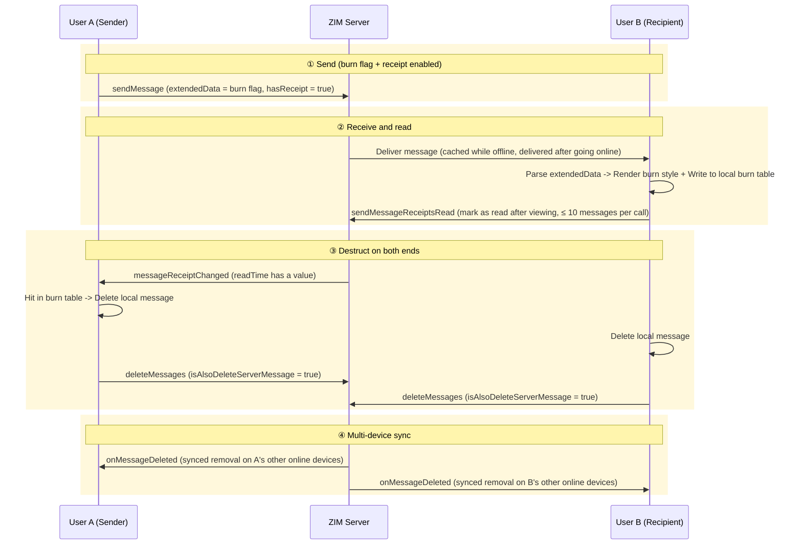

import { getPlatformData } from "/snippets/utils-content-parser.js"

export const onMessageReceiptChangedMap = {
  'Android': <a href='@onMessageReceiptChanged' target='_blank'>onMessageReceiptChanged</a>,
  'iOS': <a href='@ZIMMessageReceiptChanged' target='_blank'>messageReceiptChanged</a>,
  'mac': <a href='@ZIMMessageReceiptChanged' target='_blank'>messageReceiptChanged</a>,
  'Web': <a href='@onMessageReceiptChanged' target='_blank'>onMessageReceiptChanged</a>,
  'Flutter': <a href='@onMessageReceiptChanged' target='_blank'>onMessageReceiptChanged</a>,
}

# Implement message burn-after-reading and timed destruct
---

## Feature overview

Burn-after-reading is a signature capability for secret chat and privacy-focused communication scenarios. Sensitive content does not stay in the chat history permanently; it is automatically deleted from both parties' conversation records upon expiration or after being read.
Timed destruct means that messages are automatically deleted from both parties' conversation records after a specified time, regardless of whether they have been read.

| Requirement | Implementation | Description |
|-|-|-|
| Disappears only after the other party reads it (strict burn-after-reading) | Burn-after-reading (combined implementation) | Timed destruct has no "disappears after being read" semantics; using it alone also destructs unread messages |
| Disappears after a fixed time since being sent (unread messages included) | Timed destruct (native) | Lowest implementation cost; it is recommended to provide a "timed destruct" hint in the product UI |
| Both semantics are required (common in secret chat) | Burn-after-reading first | Timed destruct can be added as a fallback for unread scenarios; the two capabilities can be enabled at the same time without conflict |

## Implementation

### Conversation-level timed message destruct (native capability)

Conversation-level timed message destruct is a new capability added in 3.1.0 and requires the Enterprise plan. It is suitable for scenarios such as time-limited messages and confidential communication. After login, call [setConversationMessageDestructDuration](@setConversationMessageDestructDuration) to set it. Set `duration` to 0 (cancel timed destruct) or 60 \~ 604800 seconds (7 days at most);

<Note title="Note">
If you need a minimum destruct duration of 30 seconds, please contact ZEGOCLOUD Technical Support for configuration.
</Note>

The setting takes effect on both the local end and the peer end of a one-on-one chat at the same time, and on all members of a group chat at the same time. Before calling, for a one-on-one chat, the user corresponding to `conversationID` must have been registered; for a group chat, the group must have been created and the current user must have joined it.

After the setting succeeds, messages sent afterwards carry the expiration timestamp `destructTime` (in milliseconds; 0 means a non-time-limited message);
Duration changes are perceived through [onConversationChanged](@onConversationChanged). `ZIMConversation.messageDestructDuration` indicates the current duration (0 if not set). When a message expires, [onMessageDeleted](@onMessageDeleted) is triggered (with the deletion type MessagesDestructed), and the client removes the message from the message list accordingly.
<Warning title="Warning">
The duration setting only takes effect for messages sent afterwards; historical messages are not affected.
</Warning>

**Key point**: The countdown starts from when the message is sent. Even if the recipient never opens the conversation, the message is automatically destructed upon expiration. For details, refer to [Set conversation message timed destruct](../Guides/Conversation/Message%20destruct.mdx).

<Accordion title="Behavior on earlier client versions" defaultOpen="true">
In versions earlier than 3.1.0:
- The client can still receive and display the message before it expires. After expiration, if the message is already stored locally on the client, the client does not delete it automatically (local residue).
- If the client has not pulled the message before it expires, the message can no longer be obtained from the server after expiration.

Therefore, it is recommended to apply a minimum version gate (3.1.0+) to conversations using timed destruct. If the requirement is not met, block the enabling of timed destruct and guide users to upgrade the client.
</Accordion>

### Strict burn-after-reading (combined implementation)

If the product defines that a message must "disappear only after the other party reads it", ZIM can implement **burn-after-reading** by combining "message receipt read time + message deletion":

1. **Message extended data**: extendedData (visible to the peer end) carries the "burn flag" so that the receiving end can identify that the message requires burn-after-reading.
2. **Message receipts** form the read notification link (enable hasReceipt when sending; the recipient calls sendMessageReceiptsRead after viewing).
3. **Delete messages**: `deleteMessages (isAlsoDeleteServerMessage = true)` deletes the message records on both the local and server sides.

**Message sending flow**:



1. **Send**: The sender calls sendMessage (extendedData carries the burn flag, hasReceipt = true) and writes the messageID to the local burn message table;
2. **Receive and read**: The recipient parses extendedData, renders the burn style, and writes it to the local burn table; after viewing, the recipient calls [sendMessageReceiptsRead](@sendMessageReceiptsRead) (≤10 messages per call; conversation-level read is not applicable) to mark the messages as read;
3. **Destruct on both ends**: The recipient calls `deleteMessages (isAlsoDeleteServerMessage = true)` to delete the local and server records; the sender deletes likewise after receiving {getPlatformData(props, onMessageReceiptChangedMap)} (readTime has a value, 2.22.0+);
4. **Multi-device sync**: Other online devices on both ends remove the messages in sync through [onMessageDeleted](@onMessageDeleted).

Four key design points:
- Put the burn flag in extendedData (visible to the peer end, 1 KB limit, which can be raised by contacting Technical Support), not in the message body, so that it does not affect search or rendering; if the same message also needs to carry other business flags (such as the receipt switch readReceipt), put them into the same JSON object and read them by key, so they do not conflict with each other;
- Both ends maintain a "burn message table" (local storage, keyed by messageID) as the sole basis for determining "whether destruct is needed";
- The read trigger must use message-level read receipts ([sendMessageReceiptsRead](@sendMessageReceiptsRead)), not conversation-level read receipts. Obtaining the receipt read time does not yet support conversation-level read, and conversation-level read would mistakenly destruct other burn-after-reading messages in the conversation;
- The deletion must set isAlsoDeleteServerMessage = true; otherwise, after switching devices or reinstalling, the message "reappears" from the server history and the destruct promise becomes invalid. After cleanup through the delete API and the timed destruct capability, the server no longer retains the message.

### Precautions

- **One-on-one chats first** (burn-after-reading): Message receipts support one-on-one chats and group chats, but not rooms. The group-chat semantics of "destruct only after all members have read" are complex (the sender's readTime only has a value after all members have read). It is recommended to start with one-on-one chats; for group chats, consider timed destruct instead;
- **Message types** (burn-after-reading): Burn-after-reading messages can be carried by ordinary/rich media/custom messages; receipts are only unsupported for signaling messages and barrage messages;
- **Offline messages** (burn-after-reading): While the recipient is offline, messages are delivered as ordinary offline messages; destruct is triggered only after the recipient goes online and views them, which matches the "burn after reading" semantics;
- **Destruct is not absolute secrecy** (burn-after-reading): The deletion happens on both ends' local storage and server records, and cannot prevent the other party from taking screenshots or photos. Agree on the destruct timing and this boundary at the product agreement level;
- **Retry on deletion failure** (burn-after-reading): Destruct is a strong commitment. Failures enter a retry queue until success, and the retry process is hidden from users;
- **Offline destruct reconciliation** (burn-after-reading): If all of the sender's devices are offline when the recipient destructs, the sender's local messages will remain (onMessageDeleted is only synced to the online devices of the same account). Both ends should reconcile the burn table after successful login: messages that no longer exist on the server are cleared locally (for rich media, also clear the local media cache). The reconciliation logic must be compatible with both "receipt callbacks re-delivered after being offline" and "not re-delivered", and must not mistakenly clear messages that have not been destructed yet;
- **Rich media destruct must be thorough** (burn-after-reading): When images/videos are destructed, clear the local media cache files as well;
- **Version/plan pre-checks** (timed destruct): Check the 3.1.0+ version and Enterprise plan subscription status before calling; on failure, guide users explicitly in the UI instead of swallowing the error;
- **Use the SDK timestamp for the countdown** (timed destruct): Calibrate with getSDKTimestamp to prevent the perception of early/late destruct caused by users changing the local clock;
- **Tighten group-chat permissions** (timed destruct): For admin-type groups, contact Technical Support to allow only the group owner/admins to configure it;
- **Handling onMessageDeleted is a must for multi-device login**: Both paths rely on this callback to keep multiple devices consistent;
- **UI expectation management**: Display the burn indicator and the countdown/burn style on the chat page.

## Integration example

:::if{props.platform=undefined}
```java
// Set messages sent in this conversation to be automatically destructed after 5 minutes (minimum 60 seconds)
int duration = 300;
zim.setConversationMessageDestructDuration(duration, conversationID, ZIMConversationType.PEER,
    new ZIMConversationMessageDestructDurationSetCallback() {
        @Override
        public void onConversationMessageDestructDurationSet(String conversationID,
            ZIMConversationType conversationType, ZIMError errorInfo) {
            // After the setting succeeds, it takes effect on both the local end and the peer end of a one-on-one chat
        }
    });

// The peer perceives the change through the conversation change callback and updates the UI (such as the "destruct duration" indicator at the top of the chat page)
zim.setEventHandler(new ZIMEventHandler() {
    @Override
    public void onConversationChanged(ZIM zim, ArrayList<ZIMConversationChangeInfo> infoList) {
        for (ZIMConversationChangeInfo info : infoList) {
            int duration = info.conversation.messageDestructDuration; // In seconds, 0 = disabled
        }
    }
    @Override
    public void onMessageDeleted(ZIM zim, ZIMMessageDeletedInfo deletedInfo) {
        if (deletedInfo.deleteType == ZIMMessageDeleteType.MessagesDestructed) {
            // Timed destruct: no need to delete it yourself; just remove it from the message list
        }
    }
});

// Countdown display: calibrate with the SDK timestamp to avoid local clock deviation
zim.callExperimentalAPI("{\"method\":\"getSDKTimestamp\"}",
    new ZIMExperimentalAPICalledCallback() {
        @Override
        public void onExperimentalAPICalled(String result, ZIMError errorInfo) {
            // result is {"timestamp":123456} (ms); countdown = destructTime - timestamp
        }
    });
```

```java
// Sender: send a burn-after-reading message (burn flag in extendedData, sharing the same JSON with other business flags)
ZIMTextMessage message = new ZIMTextMessage("This is a burn-after-reading message");
message.extendedData = "{\"burnAfterRead\":true}";
ZIMMessageSendConfig config = new ZIMMessageSendConfig();
config.hasReceipt = true;
zim.sendMessage(message, toUserID, ZIMConversationType.PEER, config, new ZIMMessageSentCallback() {
    @Override public void onMessageAttached(ZIMMessage message) {}
    @Override public void onMessageSent(ZIMMessage message, ZIMError errorInfo) {
        // After the message is sent successfully, write the messageID to the local "burn message table"
    }
});

// Recipient: register the burn flag (only for receipt messages in the PROCESSING status)
// Trigger read + destruct after viewing: "read" is recommended to be defined as "the conversation page rendering completed"
zim.sendMessageReceiptsRead(messageList, conversationID, ZIMConversationType.PEER,
    new ZIMMessageReceiptsReadSentCallback() {
        @Override
        public void onMessageReceiptsReadSent(String conversationID,
            ZIMConversationType conversationType, ArrayList<Long> errorMessageIDs, ZIMError errorInfo) {}
    });
ZIMMessageDeleteConfig deleteConfig = new ZIMMessageDeleteConfig();
deleteConfig.isAlsoDeleteServerMessage = true;   // The server record must be deleted; otherwise the message "reappears" after switching devices
zim.deleteMessages(messageList, conversationID, ZIMConversationType.PEER, deleteConfig,
    new ZIMMessageDeletedCallback() {
        @Override
        public void onMessageDeleted(String conversationID, ZIMConversationType conversationType,
            ZIMError errorInfo) {}
    });

// Sender: destruct after receiving the read receipt (readTime has a value, 2.22.0+); failures enter the retry queue
zim.setEventHandler(new ZIMEventHandler() {
    @Override
    public void onMessageReceiptChanged(ZIM zim, ArrayList<ZIMMessageReceiptInfo> infos) {
        for (ZIMMessageReceiptInfo info : infos) {
            if (info.readTime > 0 && burnTable.containsKey(info.messageID)) {
                // deleteMessages (isAlsoDeleteServerMessage = true); other devices on both ends sync via onMessageDeleted
            }
        }
    }
});
```

:::


:::if{props.platform="ios|mac"}
```objective-c
// Set messages sent in this conversation to be automatically destructed after 5 minutes (minimum 60 seconds)
[zim setConversationMessageDestructDuration:300
                             conversationID:conversationID
                           conversationType:ZIMConversationTypePeer
                                   callback:^(NSString *conversationID,
        ZIMConversationType conversationType, ZIMError *errorInfo) {}];

// The peer perceives the change through the conversation change callback; timed destruct triggers messageDeleted (type MessagesDestructed)
- (void)zim:(ZIM *)zim conversationChanged:(NSArray<ZIMConversationChangeInfo *> *)infoList {
    for (ZIMConversationChangeInfo *info in infoList) {
        int duration = info.conversation.messageDestructDuration;   // In seconds, 0 = disabled
    }
}
- (void)zim:(ZIM *)zim messageDeleted:(ZIMMessageDeletedInfo *)deletedInfo {
    if (deletedInfo.deleteType == ZIMMessageDeleteTypeMessagesDestructed) {
        // Remove the corresponding message from the message list
    }
}

// Countdown calibration: call callExperimentalAPI with {"method":"getSDKTimestamp"} to get the current SDK timestamp (ms)
```

```objective-c
// Sender: send a burn-after-reading message
ZIMTextMessage *message = [[ZIMTextMessage alloc] init];
message.message = @"This is a burn-after-reading message";
message.extendedData = @"{\"burnAfterRead\":true}";
ZIMMessageSendConfig *config = [[ZIMMessageSendConfig alloc] init];
config.hasReceipt = true;
[self.zim sendMessage:message toConversationID:toUserID conversationType:ZIMConversationTypePeer
    config:config notification:nil callback:^(ZIMMessage * _Nonnull message, ZIMError * _Nonnull errorInfo) {}];

// Recipient: trigger read + destruct after viewing
[[ZIM getInstance] sendMessageReceiptsRead:messageList conversationID:conversationID
    conversationType:conversationType callback:^(NSString * _Nonnull conversationID,
    ZIMConversationType conversationType, NSArray<NSNumber *> * _Nonnull errorMessageIDs,
    ZIMError * _Nonnull errorInfo) {}];

ZIMMessageDeleteConfig *deleteConfig = [[ZIMMessageDeleteConfig alloc] init];
deleteConfig.isAlsoDeleteServerMessage = true;   // The server record must be deleted; otherwise the message "reappears" after switching devices
[self.zim deleteMessages:messageList conversationID:conversationID conversationType:conversationType
    config:deleteConfig callback:^(NSString * _Nonnull conversationID,
    ZIMConversationType conversationType, ZIMError * _Nonnull errorInfo) {}];

// Sender: destruct after receiving the read receipt (readTime has a value, 2.22.0+); multiple devices sync via messageDeleted
- (void)zim:(ZIM *)zim messageReceiptChanged:(NSArray<ZIMMessageReceiptInfo *> *)infos {}
- (void)zim:(ZIM *)zim messageDeleted:(ZIMMessageDeletedInfo *)deletedInfo {}
```

:::


:::if{props.platform="web"}
```typescript
// Sender: send a burn-after-reading message
const message: ZIMMessage = {
  type: 1,
  message: 'This is a burn-after-reading message',
  extendedData: JSON.stringify({ burnAfterRead: true }),
};
const config: ZIMMessageSendConfig = { hasReceipt: true, priority: 1 };
zim.sendMessage(message, toUserID, 0, config)
  .then(({ message: sent }) => burnTable.set(sent.messageID, true));

// Recipient: register the burn flag -> trigger read + destruct after viewing ("read" is recommended to be defined as "the conversation page rendering completed")
zim.on('messageReceived', (zim, { messageList }) => {
  for (const msg of messageList) {
    if (msg.receiptStatus !== 1 /* PROCESSING */) continue;
    const ext = JSON.parse(msg.extendedData || '{}');
    if (ext.burnAfterRead) burnTable.set(msg.messageID, true);
  }
});
async function burnAfterRead(message: ZIMMessage) {
  await zim.sendMessageReceiptsRead([message], conversationID, 0);
  const deleteConfig: ZIMMessageDeleteConfig = { isAlsoDeleteServerMessage: true };
  await zim.deleteMessages([message], conversationID, 0, deleteConfig);
}

// Sender: destruct after receiving the read receipt (readTime 2.22.0+); failures enter the retry queue
zim.on('messageReceiptChanged', (zim, { infos }) => {
  for (const info of infos) {
    if (!burnTable.get(info.messageID)) continue;
    const msg = messageTable.get(info.messageID);
    if (!msg) continue;
    const deleteConfig: ZIMMessageDeleteConfig = { isAlsoDeleteServerMessage: true };
    zim.deleteMessages([msg], conversationID, 0, deleteConfig)
      .catch(() => enqueueRetry(msg));   // Destruct is a strong commitment; failures enter the retry queue
  }
});

// Register on both ends: multi-device sync deletion
zim.on('messageDeleted', (zim, { messageList }) => removeFromMessageList(messageList.map(m => m.messageID)));
```

:::

:::if{props.platform="windows"}
```cpp
// The Windows SDK provides C++ interfaces (namespace zim); call them through the instance after creating the engine
// Set messages sent in this conversation to be automatically destructed after 5 minutes (minimum 60 seconds)
zim->setConversationMessageDestructDuration(300, conversationID, zim::ZIM_CONVERSATION_TYPE_PEER,
    [](const std::string &conversationID, zim::ZIMConversationType conversationType,
       const zim::ZIMError &errorInfo) {
        // After the setting succeeds, it takes effect on both the local end and the peer end of a one-on-one chat
    });

// The peer perceives the change through the conversation change callback and updates the UI (such as the "destruct duration" indicator at the top of the chat page)
class BurnEventHandler : public zim::ZIMEventHandler {
  public:
    void onConversationChanged(zim::ZIM *zim,
        const std::vector<zim::ZIMConversationChangeInfo> &infoList) override {
        for (const auto &info : infoList) {
            int duration = info.conversation->messageDestructDuration;   // In seconds, 0 = disabled
        }
    }
    void onMessageDeleted(zim::ZIM *zim, const zim::ZIMMessageDeletedInfo &deletedInfo) override {
        if (deletedInfo.messageDeleteType == zim::ZIM_MESSAGE_DELETE_TYPE_MESSAGES_DESTRUCTED) {
            // Timed destruct: no need to delete it yourself; just remove it from the message list
        }
    }
};
zim->setEventHandler(std::make_shared<BurnEventHandler>());

// Countdown display: calibrate with the SDK timestamp to avoid local clock deviation
zim->callExperimentalAPI("{\"method\":\"getSDKTimestamp\"}",
    [](const std::string &result, const zim::ZIMError &errorInfo) {
        // result is {"timestamp":123456} (ms); countdown = destructTime - timestamp
    });
```
:::

:::if{props.platform="flutter"}
```dart
// Set messages sent in this conversation to be automatically destructed after 5 minutes (minimum 60 seconds)
await ZIM.getInstance()!.setConversationMessageDestructDuration(
    duration: 300, conversationID: conversationID, conversationType: ZIMConversationType.peer);

// The peer perceives the change through the conversation change callback and updates the UI (such as the "destruct duration" indicator at the top of the chat page)
ZIMEventHandler.onConversationChanged = (zim, infoList) {
  for (final info in infoList) {
    final duration = info.conversation?.messageDestructDuration ?? 0; // In seconds, 0 = disabled
  }
};
ZIMEventHandler.onMessageDeleted = (zim, deletedInfo) {
  if (deletedInfo.messageDeleteType == ZIMMessageDeleteType.messagesDestructed) {
    // Timed destruct: no need to delete it yourself; just remove it from the message list
  }
};

// Countdown display: calibrate with the SDK timestamp to avoid local clock deviation
final result = await ZIM.getInstance()!.callExperimentalAPI('{"method":"getSDKTimestamp"}');
// result is {"timestamp":123456} (ms); countdown = destructTime - timestamp
```
:::

## FAQ

<Accordion title="Does ZIM have built-in burn-after-reading?" defaultOpen="false">
There is no strict "destruct after reading" switch. The native capability is conversation-level timed message destruct (3.1.0+, Enterprise plan), but its countdown starts when the message is sent and is independent of whether it has been read, so it only satisfies the "disappears after a time limit" semantics. If the requirement is "disappears only after being read", it must be implemented by combining "receipt read time + message deletion", and timed destruct can also be added as a fallback for unread scenarios.

</Accordion>
<Accordion title="If the recipient never opens the conversation, will the timed-destruct message still disappear?" defaultOpen="false">
Yes. The countdown starts when the message is sent and is independent of whether it has been read. Align this expectation with the product team in advance; for strict "destruct only after being read", choose the burn-after-reading combined implementation.

</Accordion>
<Accordion title="What is the minimum duration for timed destruct?" defaultOpen="false">
60 seconds (the value is 0 or 60\~604800 seconds; 0 means canceling). Therefore, the shortest implementation of "disappears within tens of seconds after being sent" is 1 minute.

</Accordion>
<Accordion title="For burn-after-reading, can I unilaterally delete a message using the delete message API?" defaultOpen="false">
The impact of deleteMessages is limited to the current account (one-sided deletion). It cannot delete the records on the other party's devices, so it cannot serve as the sole destruct method; it must be combined with the two-end convention of "the recipient also deletes + isAlsoDeleteServerMessage".

</Accordion>
<Accordion title="Does this work in group chats?" defaultOpen="false">
Timed destruct natively supports group chats (takes effect on all members; configurable by all members by default); burn-after-reading in group chats requires "destruct only after all members have read" (the sender's readTime only has a value after all members have read). "Destruct once any member has read" is inconsistent with the receipt mechanism and requires additional design on the business side. It is recommended to choose timed destruct for group chats.

</Accordion>
<Accordion title="Does the message still exist on the server after destruct?" defaultOpen="false">
No. After cleanup through the delete API (isAlsoDeleteServerMessage) and the timed destruct capability, the server no longer retains the message.

</Accordion>
<Accordion title="What is the difference between timed destruct and revoking?" defaultOpen="false">
Revoking (revokeMessage) is a manual/admin operation on a specific message with a default time window; timed destruct is a conversation-level automated policy that takes effect on all new messages after being enabled, with a fixed duration. The two can coexist.

</Accordion>
