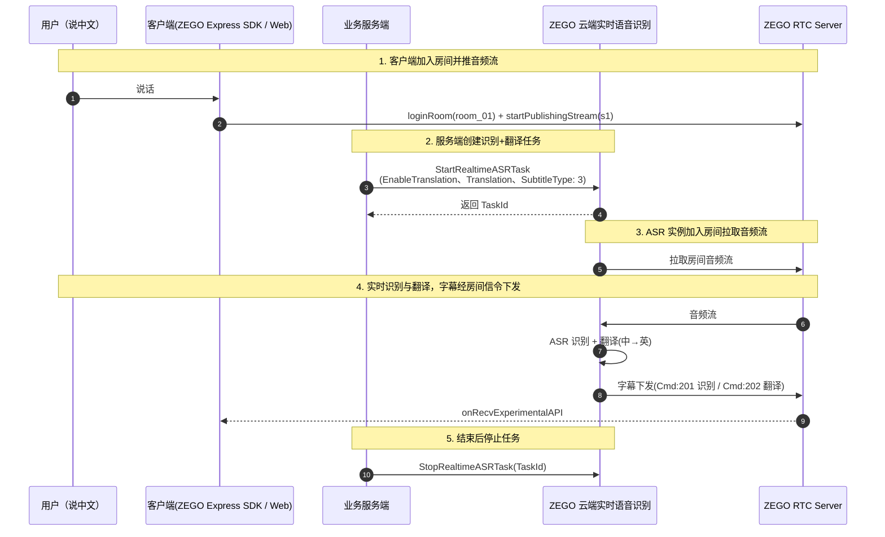

# 翻译字幕快速接入

本文带您用一个下午的时间跑通「语音识别 + 实时翻译 + 客户端字幕展示」的最短闭环：客户端进房推流，服务端创建识别翻译任务，客户端接收并渲染中英双语字幕。进阶能力（流维度差异化翻译、Qwen-MT 切换、录制字幕等）请直接参考文内链接，不在本文展开。

## 场景与效果

<Frame width="150px" height="auto" caption="">
  
</Frame>

- **跨语种 1v1 通话**：双方各说母语，实时看到对方语言的翻译字幕（进阶实操请参考 [1v1 实时翻译字幕](/cloud-realtime-asr/best-practices/translate-subtitles-during-1-on-1-calls)）。
- **多语种会议 / 在线课堂**：发言内容实时转为字幕并翻译成目标语言，降低跨语言沟通门槛。
- **直播翻译字幕**：将主播语音实时翻译成目标语言字幕，覆盖海外观众。

翻译模型可插拔：支持豆包 `doubao-seed-translation` 与 `Qwen-MT`，使用您自有的模型 API Key，翻译成本自控，详情请参考 [配置翻译](/cloud-realtime-asr/guides/enable-translation)。

## 前提条件

1. 已在 [ZEGO 控制台](https://console.zego.im/) 创建项目并获取有效的 AppID 和 AppSign，且已开通云端实时语音识别服务，详情请参考 [快速开始 - 前提条件](/cloud-realtime-asr/quick-start)。
2. 已**自行开通**翻译模型服务并获取 API Key（本文以豆包 `doubao-seed-translation` 为例）：翻译模型由您自购，调用费用由模型厂商直接收取，不经过 ZEGO 账单。开通方式与模型说明请参考 [doubao-seed-translation](https://www.volcengine.com/docs/82379/1820188?lang=zh) 或 [Qwen-MT](https://help.aliyun.com/zh/model-studio/machine-translation) 官方文档。
3. 客户端已集成 ZEGO Express SDK 并实现基本的推流功能。

<Warning title="注意">
必须使用针对 Cloud ASR 优化的特殊版本 ZEGO Express SDK，普通版本 SDK 无法正常接收和展示字幕信令。特殊版本 SDK 的获取方式请参考 [展示字幕 - 前提条件](/cloud-realtime-asr/guides/display-subtitles#use-subtitle-component)。
</Warning>

<Note title="说明">本文客户端示例基于 Web（Vue）项目。iOS / Android 的进房推流与字幕组件用法请参考 [展示字幕](/cloud-realtime-asr/guides/display-subtitles)。</Note>

## 技术原理



字幕通过 RTC 房间信令下发，两种消息以 `Cmd` 字段区分：

- **Cmd 201（识别文本）**：每轮全量下发，同一 `MessageId` 的消息直接替换上一条内容，支持前向修正。
- **Cmd 202（翻译文本）**：增量下发，需按 `SeqId` 排序后累加渲染。

字段完整定义与渲染处理流程请参考 [展示字幕](/cloud-realtime-asr/guides/display-subtitles)。

## 实现步骤

### 步骤一：客户端进房推流（Web）

<a id="client-publish-web"></a>

客户端使用 ZEGO Express SDK 登录房间并推送音频流。完整流程请参考 [Web 实现视频通话](/real-time-video-web/quick-start/implementing-video-call)；为获得最佳识别效果的音频 3A 等配置建议，请参考 [快速开始 - 客户端最佳配置实践](/cloud-realtime-asr/quick-start#integrate-zego-express-sdk)，本文不再展开。

```javascript Web（Vue）进房推流
import { ZegoExpressEngine } from "zego-express-engine-webrtc";

// 实例化引擎，scenario: 7 为高品质语聊房场景
const zg = new ZegoExpressEngine(appID, server, { scenario: 7 });

// 本文示例统一使用以下取值
const roomId = "room_01";
const userId = "u1";
const streamId = "s1";

// 登录房间（token 获取方式参考 Web 快速开始）
// !mark
await zg.loginRoom(roomId, token, { userID: userId, userName: "user_" + userId });

// 创建本地媒体流，SDK 默认开启传统音频 3A 处理
// !mark
const localStream = await zg.createZegoStream();

// 推送本地音频流，streamId 需与服务端任务配置中的流 ID 一致
// !mark
await zg.startPublishingStream(streamId, localStream);
```

<Note title="说明">iOS / Android 端的进房推流实现，请参考各端[快速开始](/cloud-realtime-asr/quick-start#integrate-zego-express-sdk)文档。</Note>

### 步骤二：服务端创建识别 + 翻译任务

<a id="server-create-task"></a>

业务服务端调用 [StartRealtimeASRTask](/cloud-realtime-asr/api-reference/start) 接口，一次性配置识别与翻译。核心请求体如下（房间维度，中文识别 → 翻译为英文，`SubtitleType: 3` 表示识别与翻译结果同时经房间信令下发）：

```json 请求体核心参数 {6-17}
{
  "RoomId": "room_01",
  "ASR": {
    "Params": { "engine_model_type": "16k_zh" }
  },
  "EnableTranslation": true,
  "Translation": {
    "Vendor": "DoubaoSeedTranslation",
    "SourceLanguage": "zh",
    "TargetLanguage": "en",
    "LLM": {
      "Url": "https://ark.cn-beijing.volces.com/api/v3/responses",
      "ApiKey": "your_doubao_api_key",
      "Model": "doubao-seed-translation-250915"
    }
  },
  "SubtitleType": 3
}
```

Node.js 发送请求的完整示例（签名参数的生成方式请参考 [调用方式](/cloud-realtime-asr/api-reference/accessing-server-apis)）：

```javascript 服务端创建识别+翻译任务（Node.js）
const https = require('https');
const querystring = require('querystring');

const data = JSON.stringify({
  RoomId: 'room_01',
  ASR: {
    Params: { engine_model_type: '16k_zh' }
  },
  // 开启翻译
  // !mark
  EnableTranslation: true,
  // 翻译配置：厂商 / 源目标语言 / 自备的豆包 LLM APIKey
  // !mark(1:10)
  Translation: {
    Vendor: 'DoubaoSeedTranslation',
    SourceLanguage: 'zh',
    TargetLanguage: 'en',
    LLM: {
      Url: 'https://ark.cn-beijing.volces.com/api/v3/responses',
      ApiKey: 'your_doubao_api_key',
      Model: 'doubao-seed-translation-250915'
    }
  },
  // 字幕下发类型：3 = 同时下发识别结果和翻译结果
  // !mark
  SubtitleType: 3
});

const params = {
  Action: 'StartRealtimeASRTask',
  AppId: '1234567890',
  SignatureNonce: 'vecj0mc2jcl',
  Timestamp: '1753691152',
  Signature: 'e8032aabe7702091b0bb2ca83cc2f98a',
  SignatureVersion: '2.0'
};

const req = https.request({
  hostname: 'cloud-realtime-asr-api.zegotech.cn',
  path: '/?' + querystring.stringify(params),
  method: 'POST',
  headers: {
    'Content-Type': 'application/json',
    'Accept': 'application/json',
    'Content-Length': Buffer.byteLength(data)
  }
}, (res) => {
  let responseData = '';
  res.on('data', (chunk) => { responseData += chunk; });
  res.on('end', () => {
    // 从响应中取出 TaskId，停止任务时使用
    console.log('Response:', JSON.parse(responseData));
  });
});

req.on('error', (error) => { console.error('Error:', error); });
req.write(data);
req.end();
```

<Note title="说明">
- 切换 Qwen-MT、按流配置不同目标语言等进阶用法，请参考 [配置翻译](/cloud-realtime-asr/guides/enable-translation)。
- 需要在业务后台接收识别 / 翻译结果（非流式）时，请参考 [接收回调](/cloud-realtime-asr/callbacks/receiving-callback)。
</Note>

### 步骤三：客户端接收并渲染字幕

<a id="client-render"></a>

#### 方式一（推荐）：使用字幕组件

Vue 项目可直接下载官方示例中的 [web/src/hooks/useChat.ts](https://github.com/ZEGOCLOUD/cloud_asr_quick_start/blob/master/web/src/hooks/useChat.ts) 到项目中使用，组件内部已处理 Cmd 201/202 的排序、全量替换与增量拼接：

```javascript Vue 使用字幕组件
import { useChat } from "./hooks/useChat";
import { onMounted, onBeforeUnmount } from 'vue';

// 传入 Express SDK 实例 zg，messages 即字幕消息列表，放入你的字幕组件中渲染
// !mark
const { messages, setupEventListeners, clearMessages } = useChat(zg);

onMounted(() => {
  // 页面加载时注册事件监听
  setupEventListeners();
});

onBeforeUnmount(() => {
  // 页面销毁时清空消息
  clearMessages();
});
```

#### 方式二：自定义解析房间信令

不使用字幕组件时，可监听 `onRecvExperimentalAPI` 回调自行解析字幕消息：

```javascript 自定义解析字幕消息
zg.on("recvExperimentalAPI", (result) => {
  const { method, content } = result;
  if (method !== "onRecvRoomChannelMessage") return;
  const msg = JSON.parse(content.msgContent);
  switch (msg.Cmd) {
    // 识别文本：全量下发，同 MessageId 直接替换
    case 201:
      updateAsrText(msg.Data);
      break;
    // 翻译文本：增量下发，按 SeqId 排序后累加
    case 202:
      appendTranslateText(msg.SeqId, msg.Data);
      break;
  }
});

// 订阅房间信令（登录房间后调用一次）
zg.callExperimentalAPI({ method: "onRecvRoomChannelMessage", params: {} });
```

消息字段定义与乱序 / 增量渲染的完整处理流程，请参考 [展示字幕](/cloud-realtime-asr/guides/display-subtitles)。

## 停止任务

通话或直播结束后，服务端调用 [StopRealtimeASRTask](/cloud-realtime-asr/api-reference/stop) 接口停止任务，`TaskId` 为创建任务时响应中返回的任务 ID：

```json
{
  "TaskId": "your_task_id"
}
```

## 常见问题

- **任务创建后 120 秒左右自动停止？** RTC 房间内超过 `MaxIdleTime`（默认 120 秒）没有真实用户时，后台会自动停止任务，并触发 `Event` 为 `Exception`、`Data.Code` 为 `1202` 的回调。请确认房间内是否有真实用户，详情请参考[异常事件错误码](/cloud-realtime-asr/callbacks/exception-codes)。
- **创建任务返回参数无效（返回码 410000003）？** 请检查 `Translation` 配置：`SourceLanguage` 与 `TargetLanguage` 不能设置为相同语言；其他参数填写要求请参考 [StartRealtimeASRTask](/cloud-realtime-asr/api-reference/start) 与[返回码](/cloud-realtime-asr/api-reference/return-codes)。
- **超过并发上限（返回码 410000011）？** 云端实时语音识别默认最大 10 路音频流识别并发，如需提升请联系 ZEGO 技术支持，详情请参考[定价](/cloud-realtime-asr/introduction/pricing)。

<Note title="成本构成">
使用本方案会产生三部分费用：① 云端语音识别费，按识别时长计费，价格见[定价](/cloud-realtime-asr/introduction/pricing)页；② RTC 音频订阅费，随通话时长产生；③ 翻译模型调用费，由您所选的 LLM 厂商（豆包 / 通义千问）直接收取，不经过 ZEGO 账单。
</Note>

## 相关文档

- [快速开始](/cloud-realtime-asr/quick-start)
- [配置翻译](/cloud-realtime-asr/guides/enable-translation)
- [展示字幕](/cloud-realtime-asr/guides/display-subtitles)
- [1v1 实时翻译字幕最佳实践](/cloud-realtime-asr/best-practices/translate-subtitles-during-1-on-1-calls)
- [接收回调](/cloud-realtime-asr/callbacks/receiving-callback)
