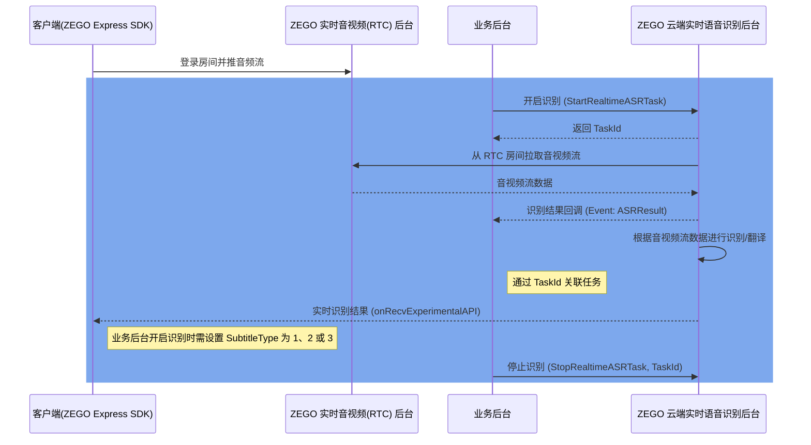

# 翻译字幕快速接入

本文以「中文 → 英文」的房间级翻译为例，介绍从客户端进房推流、服务端创建识别及翻译任务，到客户端展示翻译字幕的最短闭环。识别引擎选择、流维度差异化翻译等进阶内容，请参考本文相关文档，此处不再展开。

## 场景与效果

<Frame width="auto" height="512" caption="">
  
</Frame>

典型场景：

- **1v1 跨语种通话**：双方各说母语，实时看到对方话语的翻译字幕，详见 [1v1 实时翻译字幕](/cloud-realtime-asr/best-practices/translate-subtitles-during-1-on-1-calls)。
- **在线会议字幕**：会议发言实时转为文字字幕，跨语种参会者可直接阅读翻译结果。
- **直播实时翻译**：主播语音实时翻译成目标语言字幕，覆盖跨语种观众。

识别与翻译结果经 RTC 房间信令直接下发到客户端，无需自建推送通道。

## 前提条件

1. 已在 [ZEGO 控制台](https://console.zego.im/) 开通云端语音识别服务，详情请参考 [控制台 - 云端实时语音识别](/console/service-configuration/cloud-realtime-asr)。
2. 已自行开通翻译模型服务并获取 API Key。目前支持豆包 doubao-seed-translation、通义 Qwen-MT 等模型。

<Note title="说明">翻译模型需自行向模型厂商开通，翻译调用费用由模型厂商收取，与 ZEGO 账单无关，详见 [定价 - 翻译计费说明](/cloud-realtime-asr/introduction/pricing)。</Note>

3. 客户端已集成针对 Cloud ASR 优化的 ZEGO Express SDK。

<Warning title="注意">
必须使用 [下载 SDK 及 Demo](/aiagent-ios/introduction/download) 页面针对 Cloud ASR 优化的 ZEGO Express SDK 版本，否则无法正常显示字幕。
</Warning>

4. Web 端字幕组件基于 Vue（`useChat.ts`）实现，本文客户端步骤以 Web 为例；iOS、Android 字幕组件的用法请参考 [展示字幕](/cloud-realtime-asr/guides/display-subtitles)。

## 技术原理

使用翻译字幕服务的核心流程如下图所示：



识别与翻译结果通过 RTC 房间信令下发，协议要点如下：

- **识别结果（Cmd 201）**：每轮下发全量文本，支持前向修正，同一 MessageId 的消息直接替换上一条内容。
- **翻译结果（Cmd 202）**：以增量文本下发，同一 MessageId 的消息按 SeqId 排序后累加显示。
- 房间信令消息可能乱序到达，`SeqId` 用于消息重排及原文、译文对齐（配合 `Round`、`MessageId`），字段详情请参考 [展示字幕 - 核心说明](/cloud-realtime-asr/guides/display-subtitles)。

## 步骤一：客户端进房推流

客户端集成 ZEGO Express SDK，加入 RTC 房间并推送音频流：

1. [集成 SDK（Web）](/real-time-video-web/quick-start/integrating-sdk)
2. [实现视频通话 / 语音通话（Web）](/real-time-video-web/quick-start/implementing-video-call)

为获得最佳的识别效果，建议参考 [快速开始 - 客户端最佳配置实践](/cloud-realtime-asr/quick-start) 开启音频 3A 处理（AEC、AGC、ANS）等配置。

## 步骤二：服务端创建识别及翻译任务

业务服务端调用 [开启云端实时语音识别（StartRealtimeASRTask）](/cloud-realtime-asr/api-reference/start) 接口创建任务。请求的鉴权与签名方式请参考 [调用方式](/cloud-realtime-asr/api-reference/accessing-server-apis)；也可先在 [在线调试服务端 API](/cloud-realtime-asr/api-reference/call-api-online) 中验证请求体。

房间级「中文 → 英文」翻译的最小请求体示例：

```json 请求示例 {4-15}
{
    "RoomId": "room_01",
    "RecognitionRange": 0,
    "EnableTranslation": true,
    "SubtitleType": 3,
    "Translation": {
        "Vendor": "DoubaoSeedTranslation",
        "SourceLanguage": "zh",
        "TargetLanguage": "en",
        "LLM": {
            "Url": "https://ark.cn-beijing.volces.com/api/v3/responses",
            "ApiKey": "your_doubao_api_key",
            "Model": "doubao-seed-translation-250915"
        }
    },
    "ASR": {
        "Vendor": "Tencent"
    }
}
```

与翻译字幕相关的三个关键配置：

| 参数 | 说明 |
| --- | --- |
| `EnableTranslation` | 设为 `true`，开启翻译。 |
| `Translation` | 翻译模型配置，包括 `Vendor`（模型供应商）、`SourceLanguage` / `TargetLanguage`（翻译方向）和 `LLM`（模型的调用地址 `Url`、`ApiKey` 与模型名 `Model`）。 |
| `SubtitleType` | 设为 `3`，识别结果与翻译结果同时经房间信令下发；仅需翻译字幕时可设为 `2`。 |

<Note title="说明">
- `ASR.Vendor` 默认为 `Tencent`，更多识别厂商及模型请参考 [配置 ASR](/cloud-realtime-asr/configuring-asr)。
- 完整参数说明及流维度差异化翻译（如 1v1 双向互译），请参考 [配置翻译](/cloud-realtime-asr/guides/enable-translation)。
- 当前每个翻译配置仅支持设置一个目标语言；如需多种目标语言，请按流或房间拆分多个翻译配置，参考 [1v1 实时翻译字幕](/cloud-realtime-asr/best-practices/translate-subtitles-during-1-on-1-calls)。
</Note>

## 步骤三：客户端接收并渲染翻译字幕

任务创建成功后，识别与翻译结果经 RTC 房间信令下发，客户端有以下两种渲染方式：

1. **使用字幕组件（推荐）**：Vue 项目可直接集成官方字幕处理 Hook（`useChat.ts`）；iOS、Android 可集成对应的字幕组件源码。组件内置消息解析、按 `SeqId` 排序以及原文、译文的合并展示逻辑。
2. **自行解析渲染**：客户端监听 `onRecvExperimentalAPI` 回调，根据 `Cmd` 字段区分识别文本（201）与翻译文本（202），自行处理排序、合并与展示。

两种方式的组件源码、信令字段说明与消息处理流程，请参考 [展示字幕](/cloud-realtime-asr/guides/display-subtitles)。

## 完整示例

本节将提供将上述三个步骤串联的端到端可运行最小示例：Web 客户端加入房间并推流，服务端创建带翻译的识别任务，客户端实时渲染中英双语字幕。

### 服务端：创建识别及翻译任务

服务端基于 Node.js 实现：从环境变量读取 ZEGO AppID 与 ServerSecret，完成请求签名，调用 StartRealtimeASRTask 创建房间级「中文 → 英文」翻译任务，请求体与步骤二一致。

凭据一律从环境变量读取（`ZEGO_APP_ID`、`ZEGO_SERVER_SECRET`，翻译模型 APIKey 为 `ZEGO_TLLM_APIKEY`），严禁写死进代码。

请求签名与任务创建的关键代码如下：

```javascript server/src/signature.js
// ZEGO 服务端 API 请求签名
// 算法（见文档「调用方式 - 签名机制」）：
//   Signature = md5(AppId + SignatureNonce + ServerSecret + Timestamp)
//   SignatureNonce 为 16 位 16 进制随机字符串（8 字节随机数的 hex 编码）
import crypto from 'node:crypto';

/** 生成 16 位 hex 随机串（SignatureNonce） */
export function randomNonce() {
  return crypto.randomBytes(8).toString('hex');
}

/** 按官方算法计算签名 */
export function generateSignature(appId, signatureNonce, serverSecret, timestamp) {
  const raw = `${appId}${signatureNonce}${serverSecret}${timestamp}`;
  return crypto.createHash('md5').update(raw).digest('hex');
}

/** 组装一次请求所需的公共参数（每次调用都要生成新的签名） */
export function buildCommonParams(appId, serverSecret) {
  const nonce = randomNonce();
  const timestamp = Math.floor(Date.now() / 1000);
  const signature = generateSignature(appId, nonce, serverSecret, timestamp);
  return {
    AppId: String(appId),
    SignatureNonce: nonce,
    Timestamp: String(timestamp),
    Signature: signature,
    SignatureVersion: '2.0',
  };
}
```

```javascript server/src/asr.js
// ZEGO 云端实时语音识别服务端 API 封装
import { buildCommonParams } from './signature.js';

const API_HOST = 'https://cloud-realtime-asr-api.zegotech.cn';

/**
 * 调用一个 ZEGO 服务端 API（POST，业务参数放 Body，公共参数放 Query）
 */
export async function callZegoServerApi(action, appId, serverSecret, body) {
  const common = buildCommonParams(appId, serverSecret);
  const query = new URLSearchParams({ Action: action, ...common });
  const res = await fetch(`${API_HOST}/?${query}`, {
    method: 'POST',
    headers: { 'Content-Type': 'application/json' },
    body: JSON.stringify(body),
  });
  if (!res.ok) {
    // 非 2xx：读出 JSON 错误体，读不出则按 HTTP 状态抛出（容错细节省略）
    const text = await res.text();
    throw new Error(`HTTP ${res.status}: ${text.slice(0, 300)}`);
  }
  return res.json();
}

/**
 * 构造「房间级 中文 -> 英文」翻译识别任务请求体，与本文步骤二示例保持一致。
 * translation 为翻译模型配置，从环境变量读取（ZEGO_TLLM_*，见示例 README）。
 */
export function buildTranslationTaskBody(roomId, translation) {
  return {
    RoomId: roomId,
    RecognitionRange: 0, // 0：识别房间内所有流
    EnableTranslation: true,
    SubtitleType: 3, // 3：识别结果与翻译结果同时经房间信令下发
    Translation: {
      Vendor: translation.vendor,
      SourceLanguage: translation.sourceLanguage,
      TargetLanguage: translation.targetLanguage,
      LLM: {
        Url: translation.url,
        ApiKey: translation.apiKey,
        Model: translation.model,
      },
    },
    ASR: {
      Vendor: 'Tencent', // 默认厂商，其他厂商见《配置 ASR》
    },
  };
}

/** 创建识别及翻译任务，返回 { Code, Message, RequestId, Data: { TaskId } } */
export function startRealtimeASRTask(appId, serverSecret, body) {
  return callZegoServerApi('StartRealtimeASRTask', appId, serverSecret, body);
}
```

<Note title="说明">完整示例中，服务端还提供 Token 接口，用 AppID 与 ServerSecret 生成客户端登录房间的基础鉴权 Token（Token04），算法见[使用 Token 鉴权](/real-time-video-web/communication/using-token-authentication)；停止任务封装见下方[停止识别任务](#停止识别任务)。</Note>

### 客户端：接收并渲染翻译字幕

Web（Vue）客户端加入房间并推流，集成字幕处理 Hook（`useChat.js`，改编自官方组件源码中的 `useChat.ts`）接收房间信令，实时渲染识别原文与翻译译文。

进房推流与 Hook 接入的关键代码如下：

```javascript client/src/App.vue（关键片段）
import { ZegoExpressEngine } from 'zego-express-engine-webrtc';
import { useChat } from './hooks/useChat.js';

// 字幕 Hook：messages 为合并后的双语消息列表，放入字幕组件中渲染
const { messages, setupEventListeners, clearMessages } = useChat({
  on: (event, cb) => zg?.on(event, cb),
  callExperimentalAPI: (params) => zg?.callExperimentalAPI(params),
});

// 高品质语聊房场景（scenario: 7），与《快速开始 - 客户端最佳配置实践（Web）》一致
// AppID 与接入地址由业务服务端 /api/config 下发（非凭据）
zg = new ZegoExpressEngine(cfg.appID, cfg.serverAddress, { scenario: 7 });

async function joinAndPublish() {
  // 向业务服务端申请 Token（基础鉴权 Token04）
  const { token } = await requestToken(form.userId);
  // 加入房间并推送音频流（错误处理省略）
  await zg.loginRoom(form.roomId, token, { userID: form.userId, userName: form.userId }, { userUpdate: true });
  // 创建本地音频流（传统 3A 处理 SDK 默认开启）
  localStream = await zg.createZegoStream({ camera: { video: false, audio: true } });
  await zg.startPublishingStream(`stream_${form.userId}`, localStream, {
    enableAutoSwitchVideoCodec: true,
  });

  // 进房后注册房间信令监听，接收识别（Cmd 201）/ 翻译（Cmd 202）结果
  setupEventListeners();
}
```

`useChat` Hook 解析房间信令消息的关键代码如下：

```javascript client/src/hooks/useChat.js（关键片段）
import { ref } from 'vue';

export function useChat(zg) {
  // 双语消息列表：同一说话人同一轮（UserId + Round）的原文与译文合并为一条
  const messages = ref([]);
  let asrMsgMap = {}; // Cmd 201 历史：全量文本，取 SeqId 最大者直接替换
  let transformMsgMap = {}; // Cmd 202 历史：增量文本，按 SeqId 排序后拼接

  function handleRoomCommandMessage(msg) {
    const { Cmd, SeqId, Data, Round, Timestamp } = msg;
    if (Cmd === 201) {
      handleMessage(SeqId, Data, Round, Timestamp, 'asr');
    } else if (Cmd === 202) {
      handleMessage(SeqId, Data, Round, Timestamp, 'transform');
    }
  }

  function setupEventListeners() {
    // 监听实验性 API 回调，接收房间信令下发的识别/翻译结果
    zg.on('recvExperimentalAPI', (result) => {
      const { method, content } = result;
      if (method === 'onRecvRoomChannelMessage') {
        try {
          const recvMsg = JSON.parse(content.msgContent);
          handleRoomCommandMessage(recvMsg);
        } catch (e) {
          console.error('parse room channel message failed', e);
        }
      }
    });
    // 订阅房间通道消息（进房后调用）
    zg.callExperimentalAPI({ method: 'onRecvRoomChannelMessage', params: {} });
  }

  function clearMessages() {
    messages.value = [];
    asrMsgMap = {};
    transformMsgMap = {};
  }

  return { messages, setupEventListeners, clearMessages };
}
```

识别原文与翻译译文的排序合并逻辑（`handleMessage` 核心）如下：

```javascript client/src/hooks/useChat.js（续：Cmd 201/202 排序合并核心）
function handleMessage(seqId, data, round, timestamp, type) {
  const text = data.Text;
  if (!text) return;

  const isAsr = type === 'asr';
  const index = messages.value.findIndex(
    (m) => m.userId === data.UserId && m.round === round
  );

  const newMessage = {
    userId: data.UserId,
    round,
    seqId,
    messageId: data.MessageId,
    timestamp,
    [isAsr ? 'content' : 'translateContent']: text,
  };

  // 历史消息按轮次缓存于 msgMap（asrMsgMap / transformMsgMap）
  const msgMap = isAsr ? asrMsgMap : transformMsgMap;
  if (!msgMap[round]) msgMap[round] = [];
  msgMap[round].push(newMessage);

  if (index !== -1) {
    if (isAsr) {
      // 识别结果为全量文本：取历史中 SeqId 最大的一条，直接替换展示内容
      const latest = msgMap[round].reduce((a, b) => (b.seqId > a.seqId ? b : a));
      messages.value[index].content = latest.content;
    } else {
      // 翻译结果为增量文本：该轮所有片段按 SeqId 排序后拼接
      const merged = msgMap[round]
        .slice()
        .sort((a, b) => a.seqId - b.seqId)
        .map((m) => m.translateContent)
        .join('');
      messages.value[index].translateContent = merged;
    }
  } else {
    messages.value.push(newMessage);
  }
}
```

模板中渲染双语字幕：

```html client/src/App.vue（模板关键片段）
<article v-for="m in messages" :key="`${m.userId}-${m.round}`" class="msg">
  <p class="asr">{{ m.content }}</p>
  <p class="llm">{{ m.translateContent }}</p>
</article>
```

## 停止识别任务

通话或直播结束后，业务服务端调用 [停止云端实时语音识别（StopRealtimeASRTask）](/cloud-realtime-asr/api-reference/stop) 接口停止任务：

```json
{
    "TaskId": "your_task_id"
}
```

若房间长时间没有真实用户，任务会自动停止，详见下方常见问题。

## 常见问题

**支持热词吗？**

支持。热词通过识别厂商的 `Params` 参数配置（如 Qwen-Audio 系列模型），详见 [配置 ASR - ASR 参数](/cloud-realtime-asr/configuring-asr#asr-params)。

**识别原文和译文如何对齐？**

房间信令消息中的 `SeqId`、`Round` 与 `MessageId` 用于乱序重排与原文、译文对齐：`SeqId` 为包序列号，可能乱序，请按其排序；`Round` 为对话轮次；同一说话人的原文（Cmd 201）与译文（Cmd 202）通过 `UserId` 与 `MessageId` 关联。详见 [展示字幕 - 核心说明](/cloud-realtime-asr/guides/display-subtitles)。

**任务为什么会自动停止？**

若 RTC 房间 120 秒（默认值，可配置）内没有真实用户存在，云端实时语音识别服务会自动停止，并触发 Event 为 Exception 的回调，Data.Code 为 1202，详情请参考 [返回码](/cloud-realtime-asr/api-reference/return-codes)。请确保任务运行期间房间内存在真实用户；任务被自动停止后如需继续使用，请重新创建任务。

**源语言与目标语言相同会怎样？**

`SourceLanguage` 与 `TargetLanguage` 配置为相同语言时，任务创建失败。请检查翻译方向配置，确保两者不同。

**识别并发有上限吗？**

默认最大 10 路音频流语音识别并发。如需提升并发，请联系 ZEGO 技术支持，也可参考 [定价](/cloud-realtime-asr/introduction/pricing) 了解语音识别并发叠加包。

<Note title="说明">本方案整体成本 = ① 云端语音识别费用（按识别时长计费，见 [定价](/cloud-realtime-asr/introduction/pricing)）+ ② RTC 音频订阅费用（随通话时长产生）+ ③ 翻译模型调用费用（由您所选模型厂商收取，与 ZEGO 账单无关）。</Note>
